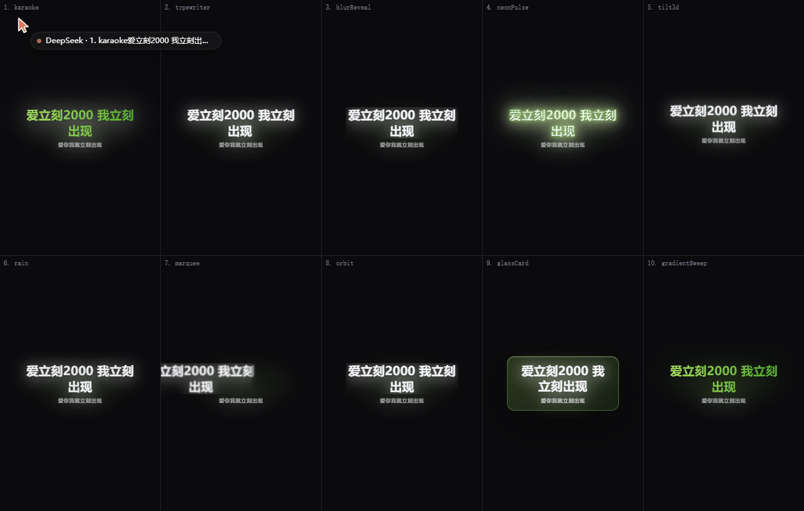

# dsh-netease-lyrics

# 注意：本项目由AI协助完成。

一边用 DSH 聊天一边听网易云的时候，有的时候也可能需要一些装帅的特效吧？既然这样，就装这个插件吧！正在唱的那句歌词会同时显示在DSH里！还可以设置缓动特效，！？帅帅？！。

一共是十个效果。显示在-1层，不影响页面所有的交互。共十种显示效果，预览如下：



可以选择30秒切换效果，每首歌一个效果，或者甚至一句词一个效果。

## 怎么用

装上插件、刷新一次页面

启动时候，它会往网易云里注入一个小模块，才能读到桌面歌词，也就是你需要开启网易云音乐的桌面歌词，可以选择成不在顶层以忽略它。插件会自己尝试注入；注入成功后即可跟随使用。如果一直没看到歌词，点歌词层右下角的齿轮，面板里点「重新注入」。网易云重启之后插件会自己再注入一次，通常不用你管。

## 能用到的功能

面板里第一组是**原文和译文怎么显示**。网易云的奇葩数据，翻译是跟在原文后面的，插件只能靠推断来分辨哪句是翻译，所以你有四种选法：翻译用小字跟在原文下面（默认）、只看原文、只看翻译，或者把原文和翻译当成前后两句歌词轮流出现（这个挺逆天的，吵眼睛）
**换场节奏**：默认每30秒换一次外观，一首歌里能看到好几种特效；也可以改成一首歌固定一套，或者每句都换，这个也不错。

**效果池**：十种效果的随机池，如果不喜欢某个效果可以关闭它们，就不会被随机到了。
**位置和外观**：歌词停在上中下、左中右哪一块可以自动选择，换位置时会带一点缓动的移动过去。
活泼感相关效果可以关，也可以速度。字号，不透明度，没歌词时多久待机、显示歌名、玻璃化强弱，这里选就行。

颜色会跟着 DSH 的明暗主题走，换主题不用改设置。如果你在 Windows 里关掉了动画效果，插件就不会用特别吵眼睛的特效了，当然你也可以覆盖行为，直接忽略系统设置，继续访问！

## 看不到歌词

先确认网易云的桌面歌词是开着的，不开的话注入不上

歌词层右下角会写出当前状态，照着看，会告诉牛你是没开桌面歌词、还是需要手动注入一次、还是网易云重启过需要重新注入，如果需要重新注入会给你按钮，再点一下就行。

如果提示都看不到，多半是插件被停用了，或者页面还没刷新，去刷新一下

歌词在但被挡住也是一种情况吧反正，歌词层在聊天面板的**下面**，面板不透明的时候就看不见，神了，谁会这么干。把面板里的「玻璃化」打开，就可以透了。

## 安装和卸载

```powershell
# 从本目录安装（link: 方式，改了源码不用重装）
dsh plugin --profile web add <本目录绝对路径>

# 或者从 npm 安装（等到时候发布了）
dsh plugin --profile web add dsh-netease-lyrics
```

新装的 client 模块要刷新一次页面（F5）才会出现。

不想用了就把它停用：`dsh plugin --profile web remove dsh-netease-lyrics`，或者在设置里关掉它。

## 关于

注入器只是把桌面歌词窗口里已经画出来的字读出来，再画到自己那一层上。因此会需要往网易云注入一个小模块，这件事只做一次，尽量避免软件纠纷。

想了解实现细节、对外接口、测试怎么跑，看 [DEVELOPING.md](DEVELOPING.md)。

插件本体 MIT 许可，详见 [LICENSE](LICENSE)；随包分发的第三方组件见 [THIRD-PARTY.md](THIRD-PARTY.md)。
